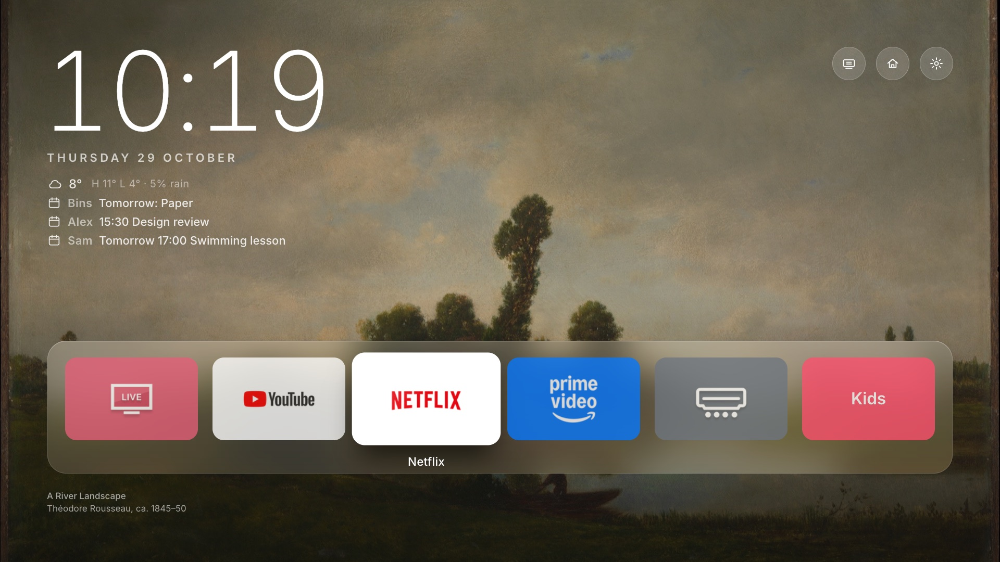
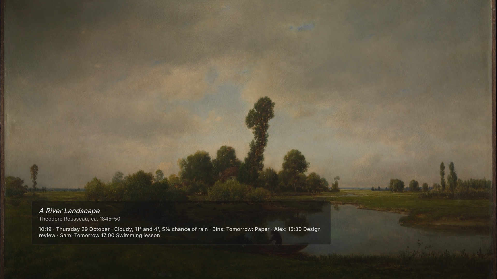
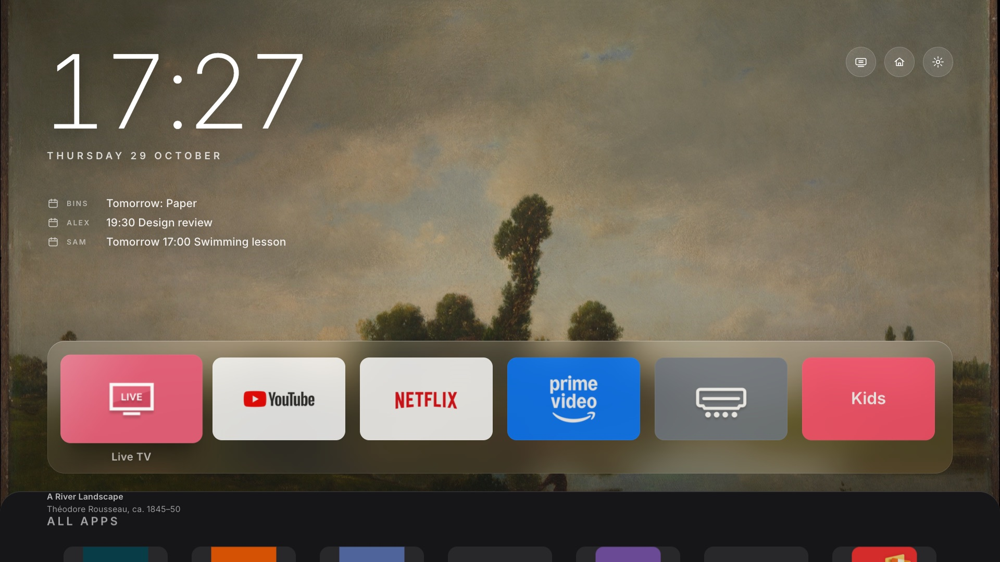
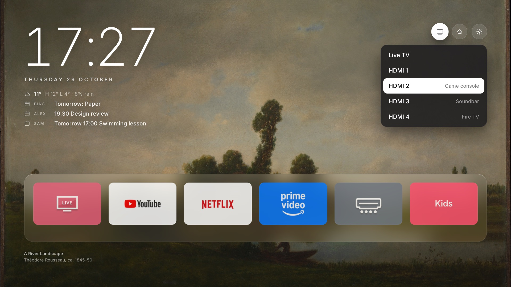
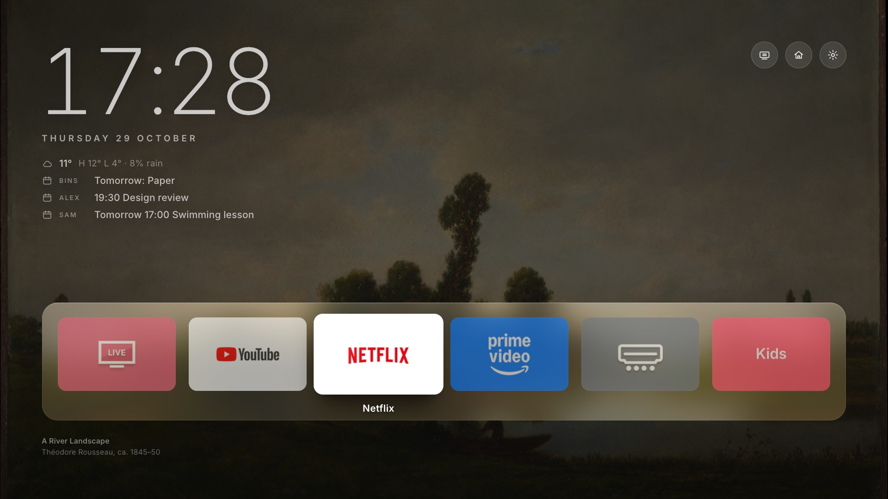

# Clean Canvas

**A calm, ad-free home screen for LG webOS TVs, with a new painting every day.**

LG's home screen is busy: sponsored rows, recommendations, an app store on the front page. Clean Canvas replaces it with a public-domain painting, a clock, the weather, your next calendar event and one row of the apps you actually use. When nobody touches the remote, it becomes a gallery: the painting full screen, with a small museum-style label.



| Gallery mode | All apps |
|---|---|
|  |  |
| **Inputs** | **Night mode** |
|  |  |

*Screenshots use made-up names and events. App logos belong to their owners.*

It installs through LG's own Developer Mode. Nothing is rooted, and nothing on the TV is removed. Uninstalling brings back exactly what was there.

Built and measured on an LG 75QNED816RE (webOS 24, 2024); it should work on webOS 6 and newer.

## What you get

- **A painting a day**: public-domain art from The Met Open Access API, landscape format and **kid-safe**. Every subject tag must be on a calm list (landscapes, rivers, villages, flowers, animals…), and anything mentioning nudity, violence, death, battles or hunting is excluded. Paintings are cached on the TV, so boot is instant, even offline.
- **Clock, weather, next event**: the time and date, today's weather from Open-Meteo (no key), with the chance of rain (`rainFrom` sets a minimum), and each person's next appointment from a published Microsoft 365 / Outlook, Google or iCloud calendar, plus reminders like bin collection days from a calendar too.
- **One row of apps**: TV apps, **web pages** (opened in LG's browser), and **apps on a Fire TV Stick** (the TV switches to its HDMI input and the app opens). Press Down for all apps.
- **Inputs, LG Home, Settings**: three small buttons. LG's home is still one press away.
- **Home button**: the remote's Home brings you back here, not to LG's home.
- **Night mode**: from sunset to sunrise, the art is darker and the text softer.
- **Gallery mode**: after 5 minutes idle, the painting fills the screen with a label like a museum wall card: *title, artist, year · 07:42 · Thursday 29 October · Cloudy, 12° and 6° · 18:30 Dinner*. After 60 more minutes, the screen turns off; any key wakes it.
- **Snappy**: vanilla HTML, CSS and JS. Every effect was measured on the TV, and focus moves hold 60 fps.
- **Clean-up checklist**: `tools/tv_settings.py` reads your TV's settings and shows what to switch off.

## Honest limits

- **Developer Mode** must stay on. LG ends a session after about 1000 hours (about 41 days) and then removes Clean Canvas. Clean Canvas renews it by itself once a week, while gallery mode runs. If the TV stays off for weeks, open the Developer Mode app and press **Extend**, or reinstall, which takes a minute.
- **LG's home appears briefly**: when you press Home it shows for about half a second before Clean Canvas comes back, and for a few seconds when the TV turns on. Without root, only LG's home can be the official start screen.
- **The pointer can't be removed**: the Magic Remote pointer is drawn by webOS. Clean Canvas ignores it, and OK always acts on the tile you chose with the arrows.
- **Background apps can't be closed**: webOS refuses to let Developer Mode apps close other apps, so Netflix and YouTube may linger in memory until webOS frees them.
- **Settings are read-only from outside**: webOS 24 lets tools read settings but not change them, so the clean-up checklist tells you what to switch; you do it in the TV's menu.

## Setup

You need a computer on the same network as the TV, with Python 3 and OpenSSH. Node.js is only needed for Fire TV tiles.

1. **Turn on Developer Mode on the TV**: install **Developer Mode** from the LG Content Store, sign in with a free account from [webostv.developer.lge.com](https://webostv.developer.lge.com), turn on **Dev Mode Status** (the TV restarts), then **Key Server**.
2. **Run the setup**:
   ```bash
   python3 tools/setup.py
   ```
   It finds the TV and pairs with it (choose **Allow** on the TV twice). Then it lists the TV's apps for you to pick the dock, looks up your town for weather and sunset, and asks for your language and calendars. It writes `app/config.local.js` and installs. The first install asks for the passphrase shown in the Developer Mode app.

Run it again to change your choices, or edit `app/config.local.js` and run `python3 tools/install.py`.

<details>
<summary>The same steps by hand</summary>

```bash
echo '{"ip": "192.168.1.50"}' > tools/tv.local.json
python3 tools/list_apps.py                 # the TV's apps and icons (the TV asks to allow)
python3 tools/list_apps.py --pair-helper   # Home button and screen off (the TV asks once more)
cp app/config.local.example.js app/config.local.js   # then edit it
python3 tools/install.py
```
</details>

**On the TV:**
- **Quick access:** with Clean Canvas open, hold **1** on the remote to pin it to that key.
- **Start screen:** set **Power On Screen** to **Home** and keep **Quick Start+** on; the helper then brings Clean Canvas up when the TV turns on.

**Uninstall:**

```bash
python3 tools/install.py --uninstall
```

## Settings

`app/config.js` holds the shared defaults: art rules, timings and behaviour. `app/config.local.js` overrides them for your TV and stays out of git.

| Setting | What it does |
|---|---|
| `apps` | The dock, left to right: `{id, title, icon, bg}` for a TV app, `{url, title, label, bg}` for a web page, `{firetv: '<package>', title, label, bg}` for a Fire TV app |
| `language` | `'en'`, `'de'`, `'he'`, `'es'` or `'fr'` for the words on screen; dates follow it in any language the TV knows |
| `place` | `{name, latitude, longitude}` for weather and sunset |
| `calendars` | `[{name, ics or file, meetingsOnly, hide, days, allDay, strip, combine}]`: one line per calendar with its next event. `file` is an `.ics` placed in `app/` (name it `*.local.ics` to keep it out of git), for example a bin schedule downloaded from your waste company. `meetingsOnly` skips all-day, Free and Away items; `hide` skips titles containing those words; `days: 2` shows only today and tomorrow; `allDay` keeps a timed event up all day; `strip` removes text from titles; `combine` joins events on the same day |
| `fireTv` | `{host: '<ip>', input: 'com.webos.app.hdmi4'}` |
| `inputs` | The Inputs menu, with optional notes (`note: 'Soundbar'`) |
| `saverAfter`, `screenOffAfter` | Minutes before gallery mode, then before the screen turns off |
| `homeTakeover` | The Home button returns to Clean Canvas |
| `art` | Sources, aspect ratio, and the kid-safe allow and block lists |

**Calendars**: every link is read-only, and anyone who has one can read that calendar, so treat it like a password. The links stay in `config.local.js`.

- **Microsoft 365 / Outlook.com**: Outlook on the web → **Settings → Calendar → Shared calendars → Publish a calendar**. Choose the calendar and **Can view all details** (or titles and locations), select **Publish**, and copy the **ICS** link.
- **Google Calendar**: on a computer, open Google Calendar → **Settings** → your calendar under "Settings for my calendars" → **Integrate calendar**, and copy **Secret address in iCal format**.
- **iCloud**: Calendar app → **Calendars** → **(i)** → **Public Calendar** → **Share Link**. `webcal://` links work as they are.

Calendar steps follow [smart-frame-tv](https://github.com/Seagey/smart-frame-tv).

**Fire TV apps**: on the Fire TV, open **Settings → My Fire TV → Developer Options → ADB debugging**. Then run `node tools/firetv.js <fire-tv-ip> pm list packages` and choose **Always allow** on the Fire TV. Use the package names in `firetv` tiles, and reserve the Fire TV's address in your router.

## Clean up the TV itself

```bash
python3 tools/tv_settings.py
```

It reads what webOS will tell it. Worth switching off in the TV's menu:
- **Live Plus**: content recognition, which watches what's on screen. *General → System → Additional Settings*.
- **Viewing Information** and **Interest-Based Ads**: *Support → Privacy & Terms*.
- **Home Promotion**: ads on LG's home. *Home Settings*.

Restart the TV now and then by unplugging it for a minute, because with Quick Start+ "off" is only standby.

## How it works

```
app/        the webOS web app: index.html, style.css, main.js (UI, focus, gallery mode), art.js, weather.js,
            calendar.js, time.js, i18n.js, tv.js, config.js (+ config.local.js, apps.js, icons/: per TV, not in git)
service/    the on-TV helper (a webOS JS service): service.js (SSAP: Home button, screen off, .ics fetch), adb.js
tools/      setup.py, install.py, build.py, list_apps.py, tv_settings.py, firetv.js, bench_listen.py, tvlib.py
```

- **Apps** open with `luna://com.webos.applicationManager/launch`. Developer Mode apps can't list apps on webOS 24, so `list_apps.py` reads the list once through the TV's remote-control API (SSAP, `wss://<tv>:3001`).
- **The helper** exists because webOS 24 denies Developer Mode apps the foreground-app and power methods. The TV's remote-control API allows them to a paired client, so the helper holds one connection and watches which app is in front. When LG's home appears, it relaunches Clean Canvas, which calls `webOSSystem.activate()` and is back in 0.1–0.6 s. Right after power-on it starts it fresh instead, because a relaunch doesn't come to the front there.
- **Paintings**: The Met's image CDN sends no CORS headers, so downloads go through `images.weserv.nl`, which also resizes them. Each painting is stored as a 1920×1080 JPEG in IndexedDB, and the next day's painting is prefetched only while nobody is using the remote.
- **The calendar** `.ics` is fetched by the helper, because calendar servers don't allow web pages to read it. It's parsed in the page: time zones, all-day events, and repeats (daily, weekly, monthly, yearly, with exceptions and moved instances).
- **Dock glass** has no `backdrop-filter`. Each painting is drawn once into a small blurred canvas, which is scaled up behind the dock.
- **Fire TV tiles**: the helper speaks just enough of the ADB protocol (`service/adb.js`) to start the app's TV activity. Fire OS refuses `monkey`, so it uses `am start`.
- **Keys** stay in `~/.ssh`: the TV's SSH key, the SSAP keys and the ADB key. The helper's keys are built into the package and never committed.

## Measured on the TV

The page renders at 4K on this TV (`devicePixelRatio` 2), so every full-screen effect was measured before it stayed in. The tools are the built-in benchmark (with `debug: true` in `config.local.js`: `--params '{"bench":true,"report":"http://<computer>:8765/"}'` and `tools/bench_listen.py`) and `/proc` over dev-mode SSH.

| | Result |
|---|---|
| Focus moves along the dock | 59.8–60 fps |
| All apps: moving focus / opening | ~57 / ~52 fps |
| Idle CPU, launcher + helper | ~5% of one core, about 40 MB RAM |
| Slow Ken Burns zoom (now off everywhere) | cost 3–6 fps while browsing, ~75% of a core in the screensaver |
| Home button → back in Clean Canvas | 0.1–0.6 s from an app, ~1–1.5 s from HDMI |

## Security and privacy

The helper service accepts only narrow requests, test hooks are off by default, and keys and personal settings never enter git. What leaves your home: weather (your place's coordinates, to Open-Meteo), paintings (The Met, through images.weserv.nl) and your calendar links. Details and how to report a problem: [SECURITY.md](SECURITY.md).

## Credits and licence

MIT licence (see `LICENSE`).

- **Free My TV** ([simbasjungles/free-my-tv](https://github.com/simbasjungles/free-my-tv), MIT): packaging, install flow and the SSAP approach are adapted from it.
- **[Clean Your TV](https://github.com/Gathin23/cleanyourtv)**: inspiration for the Apple TV-style home and the "clean up the TV" idea. Clean Canvas is a separate, independent project.
- **[smart-frame-tv](https://github.com/Seagey/smart-frame-tv)** and **[couch-tv](https://github.com/Seagey/couch-tv)**: the gallery label, the calendar-link steps, and renewing Developer Mode by opening its app with `extend`.
- **Paintings**: [The Met Open Access](https://www.metmuseum.org/about-the-met/policies-and-procedures/image-resources) (CC0).
- **Weather**: [Open-Meteo](https://open-meteo.com/) (CC BY 4.0).
- **Font**: Inter (SIL OFL, `app/fonts/OFL.txt`), subset to Latin and weights 200–600 (82 KB).

Clean Canvas isn't affiliated with LG, Amazon, Microsoft or The Met.
